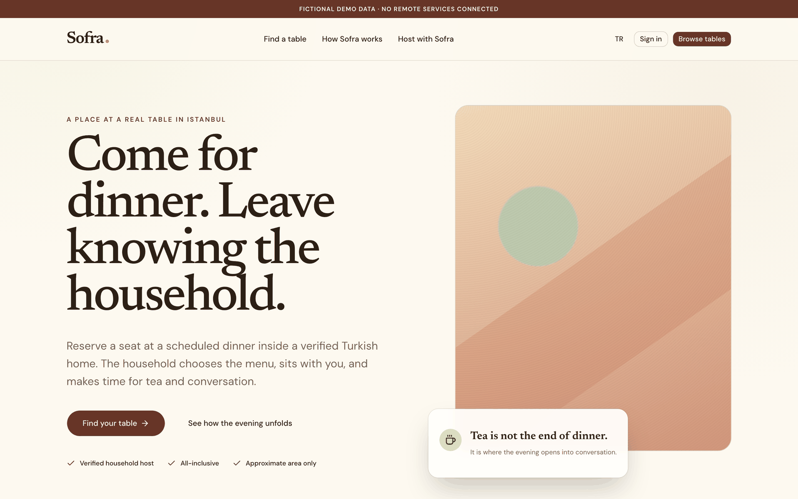
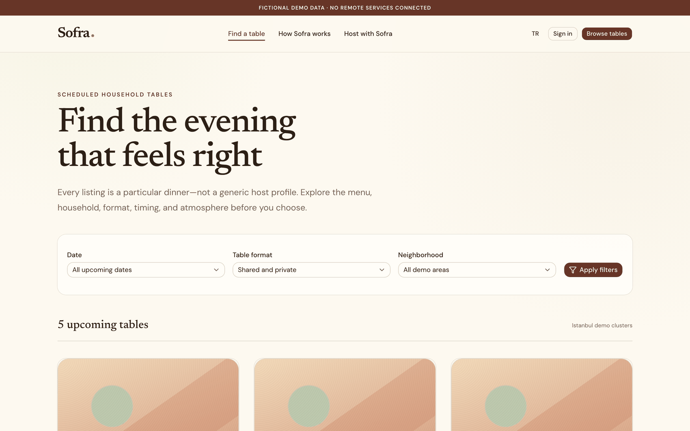
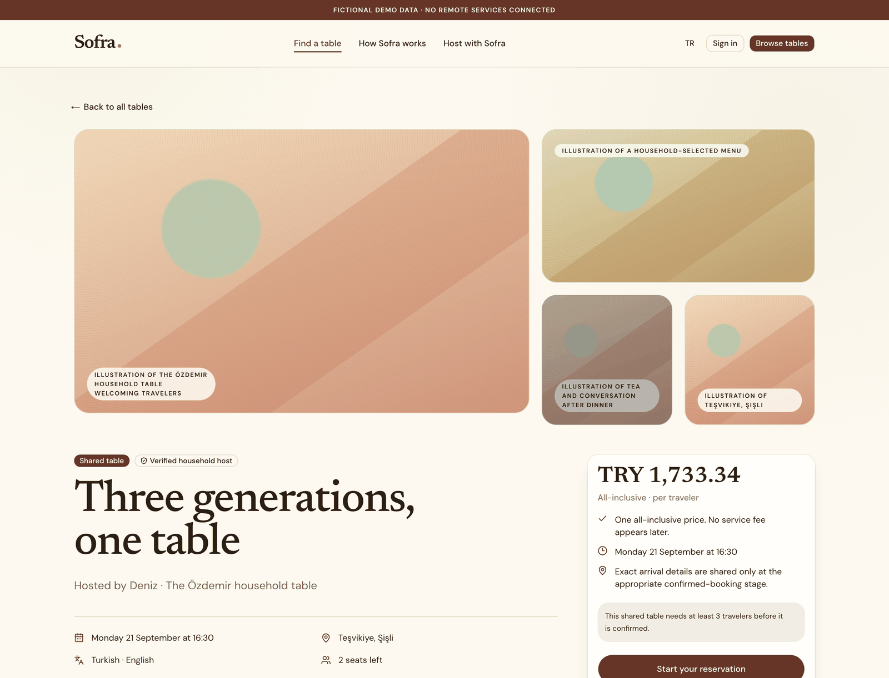

# Sofra

**A bilingual marketplace prototype for booking scheduled dinners in Turkish households.**

Sofra models the whole evening: a host proposes a table and menu, an operator
reviews it, travellers reserve seats, and the host records attendance. Public
reviews, private feedback, safety reports, and payout holds have separate
workflows.

Built with Next.js, TypeScript, PostgreSQL 18, and Better Auth. The application
has English and Turkish interfaces, 22 SQL migrations, and traveller, host,
partner, and operator workspaces. It uses fictional demo data and has no live
booking or payment service.



The screenshots show earlier local walkthroughs with the fictional-data banner.
They do not depict real households, bookings, or payment activity.

<details>
<summary>More screenshots: discovery, table details, and mobile</summary>






</details>

## Engineering walkthrough

Three concerns shape the implementation:

- **Public and private data have different read models.** Public listings select
  an explicit set of fields. Exact addresses, dietary disclosures, guest names,
  and incident reports are available only through purpose-specific authenticated
  paths. Authorization is enforced by the server and relevant SQL functions;
  the application does not use PostgreSQL row-level security.
- **Lifecycle changes are transactional.** Booking, cancellation, host/table
  review, attendance, and post-dinner reporting have database-backed write paths.
  Money is represented in integer kuruş. Ownership checks and state constraints
  sit alongside those writes.
- **Payment records are distinct from external settlement.** The iyzico adapter
  has isolated tests, but host payee onboarding and callback handling are not
  wired end to end. Without a configured provider, checkout reports unavailable
  payments. Configuring keys alone does not make it ready for real charges.

| Start here                                                                                                                   | What to inspect                                                                        |
| ---------------------------------------------------------------------------------------------------------------------------- | -------------------------------------------------------------------------------------- |
| [Public projection](src/features/hosted-tables/public-projection.ts) and [SQL read models](db/migrations/0003_functions.sql) | How public output excludes household and guest details.                                |
| [Booking service](src/server/services/bookings.ts) and [booking writes](db/migrations/0004_bookings_write.sql)               | Availability, policy checks, integer pricing, and transactional state changes.         |
| [Authorization](src/server/authorization/roles.ts) and [repositories](src/server/repositories/)                              | Actor scoping and separate traveller, host, partner, and operator contracts.           |
| [Arrival disclosure](db/migrations/0019_arrival_disclosure.sql)                                                              | Booking ownership and a configurable disclosure window before returning an address.    |
| [Payment adapters](src/server/payments/)                                                                                     | Provider interfaces, a local mock, and the incomplete iyzico integration.              |
| [Integration tests](src/server/repositories/postgres/) and [browser tests](e2e/)                                             | Real PostgreSQL checks, demo journeys, durable sign-in/writes, and responsive layouts. |

The [architecture](docs/ARCHITECTURE.md), [privacy boundaries](docs/SECURITY_AND_PRIVACY.md),
and [product decisions](docs/DECISIONS.md) explain the tradeoffs in more detail.

## Run the local walkthrough

You need **Node.js 22.22.2 or later in the 22.x line**, **pnpm 11**, and
**Docker**. The Node.js minimum matches the test toolchain. These instructions
are for local development with fictional data.

```bash
pnpm install --frozen-lockfile
cp .env.example .env.local
```

Generate a local auth secret with `openssl rand -base64 32` and save it as
`BETTER_AUTH_SECRET` in `.env.local`. Keep `SOFRA_DEMO_MODE=true`, leave payment
and notification provider credentials blank, and keep `.env.local` out of Git.

Start the database, then check that it is accepting connections:

```bash
pnpm db:up
docker exec sofra-pg pg_isready -U sofra -d sofra
```

Repeat the readiness check if it is still starting. The helper creates a
`sofra-pg` container with port 54329 bound to `127.0.0.1`. If that container
already exists, it is reused; check its database and port mapping before using
it. Existing containers keep the settings with which they were created.

Once PostgreSQL is ready:

```bash
node --env-file=.env.local db/migrate.mjs --seed
pnpm db:fixtures
pnpm dev --hostname 127.0.0.1
```

Open **http://localhost:3000/en/demo/journey** for a guided walkthrough, or
**http://localhost:3000/en** for public discovery. Switch to `/tr` for Turkish.
Demo personas let you explore each role; demo actions validate and preview
input without saving lifecycle changes.

Use these personas for the initial walkthrough. With blank Resend settings,
`/en/sign-in` does not deliver an email or print a usable sign-in link. The
durable browser suite tests real local authentication separately, with demo
mode disabled and a token read from its disposable test database.

Stop the development server with Ctrl-C and the database with `pnpm db:down`.

## Tests and database tools

```bash
pnpm format:check
pnpm lint
pnpm typecheck
pnpm test                  # unit/component tests and fixture-target checks
pnpm test:integration      # requires a disposable PostgreSQL database
pnpm test:e2e              # demo + responsive browser checks
pnpm test:e2e:durable       # real local sign-in and write checks
pnpm test:e2e:responsive   # responsive checks only
pnpm build
```

Install Chromium with `pnpm exec playwright install chromium` before browser
tests. Integration and browser checks need a separate disposable PostgreSQL 18
database with migrations and fixtures applied. Set `DATABASE_URL` and
`DATABASE_URL_UNPOOLED` explicitly for the test process. The auth layer can
consult PostgreSQL even in demo mode.

A production build reads `.env.local`; run it with demo/mock switches disabled
and test-only configuration. Build success does not establish that a production
server can start or that live integrations work. See [dated validation results](docs/VALIDATION.md)
for what was run and the remaining limits.

Useful database commands are `pnpm db:migrate`, `pnpm db:fixtures`, and
`pnpm db:types`. **`pnpm db:reset` drops the entire public schema**; use it only
on a disposable database. Migrations prefer `DATABASE_URL_UNPOOLED` when set.
The fixture loader accepts only plain PostgreSQL URLs targeting exactly
`localhost` or `127.0.0.1`, without query parameters or fragments. Fixtures can
still overwrite data in an existing local database, so check the target.

## Current limits

- No live payment, refund, host onboarding, or settlement validation. A durable
  booking can remain reserved with payment pending; a recorded payout decision
  is not evidence of a bank transfer.
- Shared-table minimum decisions and reversals of recorded financial outcomes
  have unresolved implementation or policy gaps.
- Production identity verification, host certification operations, and legal,
  tax, and food-safety readiness are not established.
- Browser evidence covers Chromium with the development server. It does not
  establish cross-browser or production deployment behavior.

[Open questions](docs/OPEN_QUESTIONS.md) tracks the remaining product and
operational decisions. [Deployment notes](docs/DEPLOYMENT.md) describe the
production configuration boundary.

## Stack and ownership

Next.js App Router, React, TypeScript, PostgreSQL with raw SQL via postgres.js,
Better Auth passwordless sign-in, next-intl, Tailwind CSS, and locally maintained
shadcn/ui components. Vitest, Testing Library, and Playwright provide automated
coverage. The lockfile is included.

Built by [Mehmet E. Mayda](https://maydalabs.com/profile) at
[MaydaLabs](https://maydalabs.com).

Licensed under [MIT](LICENSE). See [asset provenance](docs/ASSET_PROVENANCE.md)
for the original social card, fictional-data screenshots, and third-party notices.
